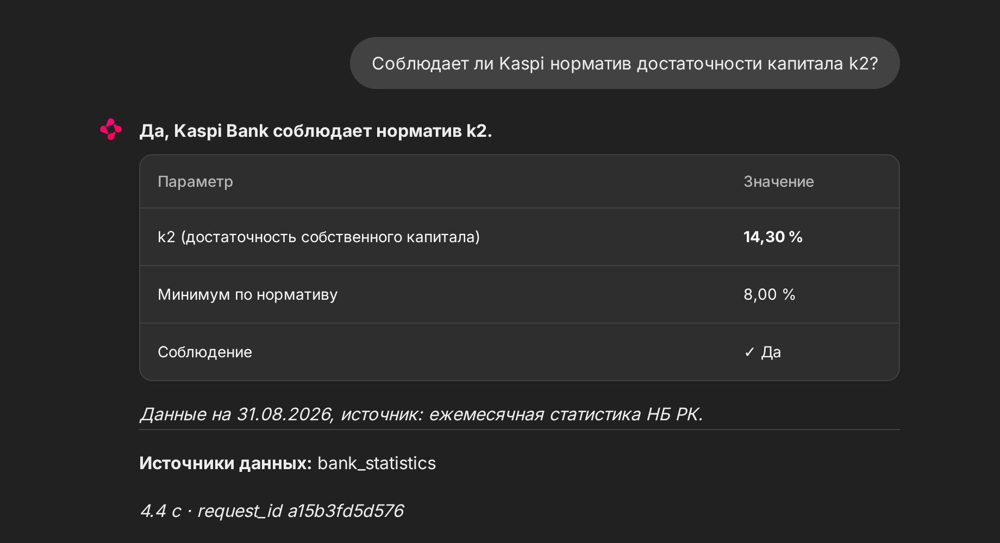

# fin-assistant

## Overview

A self-hosted risk assistant for Kazakhstan's banking sector. It answers questions in Russian or English from 16 datasets: National Bank statistics, bank balance sheets, exchange rates, credit ratings, laws, regulations and company filings (about 6,300 documents and 530,000 figures). A Qwen3.8-27B agent served by vLLM calls typed tools over PostgreSQL and pgvector; every number in an answer is checked against the tool results before it is returned, and the whole stack runs without internet access.

## Installation

```bash
git clone https://github.com/Zk816/fin-assistant.git && cd fin-assistant
cp .env.example .env
uv sync
docker compose -f deploy/docker-compose.yml --env-file .env up -d
uv run python scripts/init_db.py
scripts/refresh.sh --full
```

## Usage

```bash
curl -s localhost:8400/v1/ask -H "X-API-Key: $API_KEY" -H "Content-Type: application/json" \
  -d '{"question": "Соблюдает ли Kaspi норматив k2?"}'
```

Chat UI: `http://localhost:8401`. Excel statements: `POST /v1/analyze`. Evaluation:

```bash
uv run python eval/run_pro.py --agent assistant --set holdout
```

## Performance

| | Result |
|---|---|
| Expert questions (development set) | 49/50 |
| Held-out questions, never used for tuning | 32/32 |
| Held-out questions, internet blocked | 32/32 |
| Median answer time | 3.7 s |
| LoRA reranker, MRR@10 on held-out documents | 0.471 → 0.496 |
| QLoRA Qwen3-8B, correct grounded answers | 76% → 85% |

## Demo


